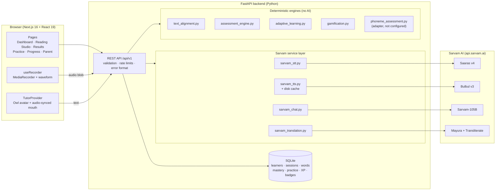
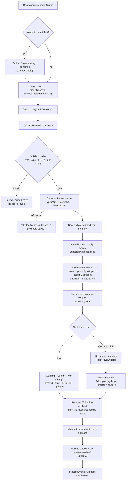
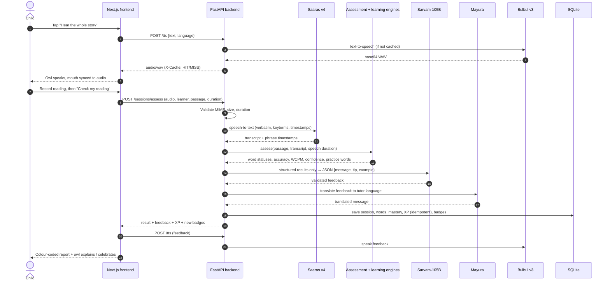
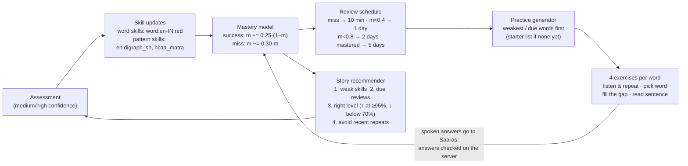

# BoloBuddy (बोलो Buddy) — AI Reading Fluency Coach

> A friendly AI reading tutor that **listens** to a child read aloud, **measures** the reading against the original text, **speaks** words back in a natural Indian voice, and turns tricky words into **personalised practice**. Powered end to end by **Sarvam AI**.

**Builder:** Mohd Hammad Ansari (3rd-year student)

---

## Table of contents
1. [The problem](#the-problem)
2. [What BoloBuddy does](#what-bolobuddy-does)
3. [How Sarvam AI is used](#how-sarvam-ai-is-used)
4. [System architecture](#system-architecture)
5. [Information flow: one reading session](#information-flow-one-reading-session)
6. [How a reading is scored](#how-a-reading-is-scored)
7. [Adaptive practice loop](#adaptive-practice-loop)
8. [Rewards and progress](#rewards-and-progress)
9. [Project structure](#project-structure)
10. [API reference](#api-reference)
11. [Run it locally](#run-it-locally)
12. [Testing](#testing)
13. [Privacy and safety](#privacy-and-safety)
14. [Known limitations and roadmap](#known-limitations-and-roadmap)

---

## The problem
- Children improve at reading by **reading aloud to someone who listens**, but a teacher can't listen to every child every day.
- Most reading apps are **English-first** and ignore Indian languages and accents.
- Generic AI chatbots **guess** at feedback instead of measuring what the child actually read.

## What BoloBuddy does

| Screen | What happens |
|---|---|
| **Landing** | Product intro, animated tutor preview, privacy note, plus a one-click demo learner. |
| **Onboarding** | A parent or teacher enters a nickname, age band, reading language, tutor language, level and daily goal. No real names or contact details. |
| **Dashboard** | Tutor greeting, today's recommended story (with the reason it was chosen), XP and level, streak, daily quests, weekly chart, badges and a skills map. |
| **Reading Studio** | Story card with sentence navigation, "hear the story" and "hear this sentence" buttons, a big mic button, pause/resume, timer, live waveform, playback and re-record, plus optional transliteration and translation helper text. |
| **Results** | Accuracy %, words correct per minute (WCPM), words matched, reading time and confidence. The story is colour-coded word by word; tap a word to hear it alone or in a sentence. |
| **Practice Arena** | Four exercise types generated from the child's own tricky words: *listen & repeat*, *pick the word you heard*, *fill the gap* and *read a sentence*. |
| **Progress** | Accuracy and WCPM trend, 4-week learning calendar, badges, skill mastery bars and session history. |
| **Parent / Teacher** | All learners with reading frequency, trends, tricky words, developing skills and suggested next step. Learner profiles can be deleted. |

The **animated owl tutor** (`TutorAvatar`) has 9 states: idle, greeting, speaking, listening, thinking, encouraging, explaining, celebrating and error. Each is tied to a real app event, and its mouth moves with the actual Bulbul audio through a Web Audio analyser.

---

## How Sarvam AI is used

| Sarvam model / API | Endpoint | Used for |
|---|---|---|
| **Saaras v4** (speech-to-text) | `POST /speech-to-text` | Transcribing the child's reading in `verbatim` mode, so repetitions and fillers are kept. The story's target words are sent as `keyterms` to help recognition. Phrase timestamps give the true speaking duration. |
| **Bulbul v3** (text-to-speech) | `POST /text-to-speech` | The tutor's voice: whole story, single sentence, single word (slowed down), greetings and feedback. Audio is cached on disk. |
| **Sarvam-105B** (chat) | `POST /v1/chat/completions` | Short, age-appropriate encouragement and a practice tip, as structured JSON checked with Pydantic. The model only sees the measured results and never makes up scores. |
| **Mayura v1** (translation) | `POST /translate` | Speaking the greeting and feedback in the tutor language, and showing a story's meaning. |
| **Transliteration** | `POST /transliterate` | Roman-script pronunciation help for Hindi stories. |

All calls go through one backend client (`sarvam_client.py`) with timeouts and up to 2 retries with increasing wait times on 429 and 5xx errors. **The API key never reaches the browser.**

Language support differs per model, so reading languages are limited to those supported by **both** Saaras and Bulbul (`backend/app/languages.py`).

---

## System architecture



**Design rule:** the AI models *perceive* (speech to text) and *communicate* (text to speech, encouragement, translation). All **scoring, mastery, scheduling and rewards are plain deterministic Python**, so results can be reproduced, tested and explained.

---

## Information flow: one reading session

### Big picture



### Request by request



---

## How a reading is scored

All scoring lives in `backend/app/engine/` and is covered by unit tests.

**1. Normalise** (`text_alignment.py`): Unicode NFC, strip punctuation including the Devanagari danda `।`, and lowercase **English only**. Matras, nukta and diacritics are **kept**, so different Hindi words such as `पीला` and `पिला` are never merged. Fillers ("um", "uh") are removed and counted.

**2. Align**: a Levenshtein dynamic-programming alignment over words. Near matches (spelling similarity of 0.75 or more, e.g. `flower` vs `flowers`) cost less and are labelled **uncertain** instead of wrong.

**3. Classify each expected word**

| Status | Meaning | Colour |
|---|---|---|
| `correct` | Recognised as the expected word | green |
| `likely_substitution` | A different word was recognised | red |
| `likely_omission` | The word wasn't heard | amber |
| `uncertain` | Close match; could be ASR, accent or grammar | grey |
| `not_attempted` | Every word after the last one recognised (the child stopped) | muted |

**4. Metrics**

```
reading_duration  = speech span from Saaras timestamps (falls back to the recording timer)
wcpm              = correct words / (reading_duration / 60)
word_accuracy %   = correct words / expected words × 100
attempted acc %   = correct words / attempted words × 100
```

*Example:* 83 correct of 90 attempted words in 65 s gives WCPM = 83 / (65/60) ≈ **76.6** and attempted accuracy ≈ **92.2%**.

**5. Confidence check**: the score starts at 1.0 and is reduced for an empty transcript, very short audio, unrealistic speed, a partial attempt, many extra words (noise) or a very high mismatch rate. The result is **high / medium / low**. Low-confidence readings show a retry warning, earn only effort XP and **do not change the child's skill profile**.

> A mismatch is always reported as a *possible* issue, never as "mispronounced". The speech recogniser, an accent or a hesitation could also be the cause.

---

## Adaptive practice loop



- Exercises are saved on the server with their answers, so **the browser can't submit a fake result**.
- Practice items belong to one learner; another learner's ID gets a 404.

---

## Rewards and progress

| Reward | Rule |
|---|---|
| Reading XP | 20 + accuracy/10 (low confidence: 5 effort XP) |
| Practice XP | 5 if correct, 2 for trying |
| Daily quests | Read 1 story (+10), practise 3 words (+10), score 85%+ accuracy (+15) |
| Badges | First Steps, Bookworm (5 readings), Sharp Reader (90%+), On a Roll (3-day streak), Word Wizard (10 practice exercises) |
| Level | One level per 100 XP |

Every XP grant has a **unique idempotency key** (`session:<id>`, `practice:<attempt_id>`, `quest:<id>:<date>`) backed by a `UNIQUE` database constraint, so **refreshing the page or resending a request never grants XP twice**.

---

## Project structure

```
.
├── .env.example                 # copy to .env and add SARVAM_API_KEY
├── backend/
│   ├── app/
│   │   ├── main.py              # FastAPI routes, validation, persistence
│   │   ├── config.py            # env settings, live vs demo mode
│   │   ├── languages.py         # Saaras / Bulbul / Mayura language matrix
│   │   ├── schemas.py           # Pydantic request models
│   │   ├── db.py                # SQLite schema + idempotent XP helper
│   │   ├── data/passages.py     # curated stories (5 English, 2 Hindi) + skills
│   │   ├── services/            # Sarvam layer
│   │   │   ├── sarvam_client.py #   auth, timeouts, retries
│   │   │   ├── sarvam_stt.py    #   Saaras v4 (+ labelled demo mock)
│   │   │   ├── sarvam_tts.py    #   Bulbul v3 + cache
│   │   │   ├── sarvam_chat.py   #   Sarvam-105B tutor feedback
│   │   │   └── sarvam_translation.py  # Mayura + transliteration
│   │   └── engine/              # deterministic logic
│   │       ├── text_alignment.py
│   │       ├── assessment_engine.py
│   │       ├── adaptive_learning.py
│   │       ├── gamification.py
│   │       └── phoneme_assessment.py  # adapter for a future model
│   ├── tests/                   # pytest: assessment, learning, API
│   └── scripts/
│       ├── smoke_live.py        # quick live check of each Sarvam API
│       └── e2e_live.py          # full live learner journey (17 checks)
└── frontend/
    ├── app/                     # Next.js App Router pages
    │   ├── page.tsx             # landing
    │   ├── onboarding/  dashboard/  read/[id]/
    │   └── practice/  progress/  parent/
    ├── components/              # TutorAvatar, TutorPanel, Results, exercises, ui
    └── lib/                     # api client, tutor voice provider, recorder hook
```

---

## API reference

All routes are under `http://localhost:8000/api/v1`. Errors always use the same shape: `{"error": {"code": "...", "message": "..."}}`.

| Method | Route | Purpose |
|---|---|---|
| GET | `/health` | Live or demo mode and model names |
| GET | `/languages` | Language support matrix |
| GET | `/passages?language=` | Story library |
| GET | `/passages/{id}` | One story with its sentences |
| GET | `/passages/{id}/aids?tutor_language=` | Transliteration + translation (shown beside the story, never instead of it) |
| POST | `/learners` | Create a learner |
| GET | `/learners` | List learners |
| DELETE | `/learners/{id}` | Delete a learner and all their data |
| GET | `/learners/{id}/greeting` | Greeting in the tutor language |
| GET | `/learners/{id}/dashboard` | XP, streak, quests, badges, recommendation, skills, trends |
| POST | `/sessions/assess` | **Upload a reading → full pipeline → results** |
| GET | `/sessions/{id}` | Fetch a past result |
| POST | `/tts` | Bulbul speech (cached) |
| GET | `/learners/{id}/practice` | Generate personalised exercises |
| POST | `/practice/choice` | Answer a multiple-choice exercise (idempotent) |
| POST | `/practice/spoken` | Answer a spoken exercise (Saaras) |
| GET | `/parent/overview` | Parent / teacher report |

Interactive docs are at `http://localhost:8000/docs`.

---

## Run it locally

**Requirements:** Python 3.11+, Node.js 20+, and a Sarvam API key from [dashboard.sarvam.ai](https://dashboard.sarvam.ai/).

```bash
# 1. Secrets (backend only)
cp .env.example .env            # Windows: copy .env.example .env
# edit .env → SARVAM_API_KEY=sk_...

# 2. Backend → http://localhost:8000
cd backend
python -m venv .venv
.venv\Scripts\activate          # macOS/Linux: source .venv/bin/activate
pip install -r requirements.txt
uvicorn app.main:app --port 8000

# 3. Frontend → http://localhost:3000  (new terminal)
cd frontend
npm install
npm run dev
```

Open **http://localhost:3000**, click **Try a quick demo**, then **Start Reading**.

### Environment variables

| Variable | Where | Default | Purpose |
|---|---|---|---|
| `SARVAM_API_KEY` | backend | — | Enables live Sarvam mode |
| `BOLOBUDDY_DEMO_MODE` | backend | `false` | Force demo mode even when a key is set |
| `BOLOBUDDY_TTS_SPEAKER` | backend | `ritu` | Bulbul v3 voice |
| `CORS_ORIGINS` | backend | `http://localhost:3000,...` | Allowed frontend origins |
| `NEXT_PUBLIC_API_URL` | frontend | `http://localhost:8000` | Backend URL |

### Demo mode
With no key, the app still runs. Every result is **clearly labelled as mock data**, with an amber banner and a `demo-mock` source. The tutor uses the browser's built-in voice, marked "Browser voice (demo mode)". Mock results never update skill mastery.

### Troubleshooting
- **Microphone blocked:** click the lock icon in the address bar, allow the microphone, and reload. Recording needs `localhost` or HTTPS.
- **"Can't reach the BoloBuddy server":** start the backend on port 8000, or set `NEXT_PUBLIC_API_URL`.
- **CORS error:** add your frontend URL to `CORS_ORIGINS`.
- **Badge says "Demo mode":** `SARVAM_API_KEY` is missing from `.env` in the repo root. Restart the backend after adding it.
- **Code changes not showing on Windows:** restart `uvicorn`, because `--reload` doesn't always pick up changes.

---

## Testing

```bash
cd backend
.venv\Scripts\python -m pytest -q             # 23 unit + API tests (no key needed)
.venv\Scripts\python scripts\smoke_live.py    # one call to each Sarvam API
.venv\Scripts\python scripts\e2e_live.py      # full live journey (backend must be running)
```

| Suite | Covers | Result |
|---|---|---|
| `pytest` | alignment, Hindi normalisation, WCPM and accuracy maths, skipped / different / uncertain / partial / empty readings, fillers, mastery, story recommendation, streaks, audio validation, demo labelling, XP idempotency, learner isolation, Sarvam retry handling | **23 / 23 pass** |
| `e2e_live.py` | live Saaras transcription, 100% on a clean reading, detecting a deliberately skipped word, Hindi reading, Bulbul audio + cache, Sarvam-105B feedback, Hindi translation, practice generation + spoken grading, no double XP, transliteration, dashboard, parent view, error handling | **17 / 17 pass** |
| Frontend | `tsc --noEmit` and `eslint` | clean |

> The live test uses Bulbul-generated speech in place of a child's voice. Real children's recordings are harder to recognise and should be checked against educator-scored samples.

---

## Privacy and safety
- Only a **nickname, age band and language** are collected.
- **Recordings are processed in memory and never stored.**
- The Sarvam key exists only on the backend; the browser never calls Sarvam directly.
- Uploads are checked for type, size (≤ 5 MB) and duration (1–30 s), and rate-limited per IP.
- The LLM receives structured results only and is told never to invent scores or say a word was mispronounced.
- Every score is labelled as an **automated estimate**, not a validated assessment.
- Parents and teachers can **delete a learner and all their data**.

---

## Known limitations and roadmap

| Now | Next |
|---|---|
| SQLite + learner ID in the browser | Supabase Auth, Postgres and row-level security for parents and teachers |
| Recordings up to 30 s (Saaras REST) | Saaras batch API for longer stories |
| Word-level feedback only | Validated phoneme scoring through the `phoneme_assessment.py` adapter |
| 4 exercise types | Letter-sound matching and repeated-reading comparison |
| 7 curated stories (English and Hindi) | More languages Saaras and Bulbul both support (Bengali, Tamil, Telugu…) with educator-reviewed text and audio |
| Machine translation shown as helper text | Educator-reviewed translations |

---

Built for the **Sarvam AI Hackathon** with Saaras v4, Bulbul v3, Sarvam-105B and Mayura.
